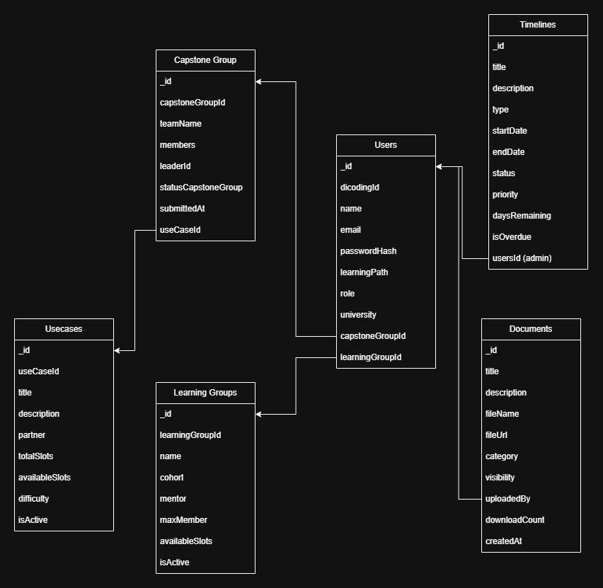

# API Documentation - Dicoding Academic Dashboard

**Last Updated:** 10 November 2025  
**Base URL:**

- Development: `http://localhost:8000/api/`

---

## 𝄜 Relational Database (ERD)



---

## 📋 Table of Contents

1. [Authentication](#authentication)
2. [Users](#users)
3. [Capstone Groups (Teams)](#capstone-groups)
4. [Use Cases](#use-cases)
5. [Documents](#documents)
6. [Timeline](#timeline)
7. [Learning Groups](#learning-groups)
8. [Error Handling](#error-handling)

---

## 🔐 Authentication

All protected endpoints require a Bearer token in the Authorization header.

### Headers

```
Authorization: Bearer <token>
Content-Type: application/json
```

### Login

```http
POST: /api/auth/login
```

**Request Body:**

```json
{
  "email": "user@example.com",
  "password": "password123"
}
```

**Response (200 OK):**

```json
{
  "success": true,
  "data": {
    "user": {
      "_id": "507f1f77bcf86...",
      "name": "Afrizal",
      "email": "afrizal@example.com",
      "role": "student",
      "learningPath": "Front-End"
    },
    "token": "eyJhbGciOiJIUzI1NiIsInR5cCI6IkpXVCJ9..."
  }
}
```

### Register

```http
POST: /api/auth/register
```

**Request Body:**

```json
{
  "name": "Example",
  "email": "example@example.com",
  "password": "password123",
  "learningPath": "Front-End Web & Back-End with AI",
  "university": "Universitas X"
}
```

**Response (201 Created):**

```json
{
  "success": true,
  "message": "User registered successfully",
  "data": {
    "_id": "690ed7bf3d43f...",
    "dicodingId": "FBXXXXXAI",
    "name": "Example",
    "email": "example@gmail.com",
    "password": "$2b$15$.R6TvE0S.NTM3w7jqeh25O...",
    "learningPath": "Front-End Web & Back-End with AI",
    "role": "student",
    "university": "Unviersitas X",
    "capstoneGroupId": null,
    "learningGroupId": null,
    "createdAt": "2025-11-08T05:40:15.838Z",
    "updatedAt": "2025-11-08T05:40:15.838Z"
  }
}
```

---

## 👥 Users

### Get Current User Profile

```http
GET: /api/users/profile
```

**Headers:** `Authorization: Bearer <token>`

**Response (200 OK):**

```json
{
  "success": true,
  "data": {
    "_id": "690cce6f3...",
    "dicodingId": "FEBEXXXXXAI",
    "name": "example",
    "email": "example@gmail.com",
    "learningPath": "Front-End Web & Back-End with AI",
    "role": "student",
    "university": "Unviersitas X",
    "capstoneGroupId": null,
    "learningGroupId": null
  }
}
```

### Update User Profile

```http
PUT: /api/users/profile
```

**Headers:** `Authorization: Bearer <token>`

**Request Body:**

```json
{
  "name": "exampleUpdated",
  "email": "exampleUpdated@example.com",
  "password": "passwordUpdated",
  "university": "universitas X Updated"
}
```

**Response (200 OK):**

```json
{
  "success": true,
  "message": "User profile updated successfully",
  "data": {
    "_id": "690cce6f38d...",
    "dicodingId": "FEBEXXXXXAI",
    "name": "exampleUpdate",
    "email": "exampleUpdate@example.com",
    "password": "$2b$15$dFFXkKsFHrv10...",
    "learningPath": "Front-End Web & Back-End with AI",
    "role": "student",
    "university": "universitas X Updated",
    "capstoneGroupId": null,
    "learningGroupId": null,
    "updatedAt": "2025-11-08T06:43:38.913Z"
  }
}
```

### Get All Users (Admin Only)

```http
GET: /api/users
```

**Query Parameters:**

- `role` - Filter by role (student, admin, mentor)
- `learningPath` - Filter by learning path
- `page` - Page number (default: 1)
- `limit` - Items per page (default: 10)

**Response (200 OK):**

```json
{
  "success": true,
  "data": {
    "users": [ ... ],
    "pagination": {
      "currentPage": 1,
      "totalItems": 50,
      "itemsPerPage": 10
    }
  }
}
```

---

## 👨‍👩‍👧‍👦 Capstone Groups (Teams)

### Create Capstone Group

```http
POST: /api/capstone-group/add
```

**Request Body:**

```json
{
  "useCaseId": "ID-UseCase",
  "teamName": "Tim Awesome",
  "membersUserId": [
    "FBXXXXXAI",
    "MLXXXXX",
    ...
  ]
}
```

**Response (201 Created):**

```json
{
  "success": true,
  "data": {
    "_id": "6910d07b416556324d0eb025",
    "capstoneGroupId": "TI-015",
    "useCaseId": "690eb63cbf...",
    "teamName": "example",
    "membersUserId": ["690f50f35af...", "690f51065af..."],
    "status": "pending",
    "validatedBy": null,
    "validatedAt": null,
    "rejectionReason": null,
    "submittedAt": "2025-11-09T17:33:47.416Z",
    "__v": 0
  }
}
```

### Get All Capstone Groups

```http
GET: /api/capstone-groups
```

**Query Parameters:**

- `status` - Filter by status (draft, pending, approved, rejected)
- `page` - Page number
- `limit` - Items per page

**Response (200 OK):**

```json
{
  "success": true,
  "data": {
    "capstoneGroup": [
      {...}
    ],
    "pagination": {
      "currentPage": 1,
      "totalItems": 3,
      "limit": 10
    }
  }
}
```

### Get Capstone Group by ID

```http
GET: /api/capstone-group/:id
```

**Response (200 OK):**

```json
{
  "success": true,
  "data": {
    "_id": "6910d07b41...",
    "capstoneGroupId": "TI-XXX",
    "useCaseId": "690eb63cbf...",
    "teamName": "example",
    "membersUserId": ["690f50f35a...", "690f51065a..."],
    "status": "pending",
    "validatedBy": null,
    "validatedAt": null,
    "rejectionReason": null,
    "submittedAt": "2025-11-09T17:33:47.416Z"
  }
}
```

### Update Team

```http
PUT: /api/capstone-group/update/:id
```

**Request Body:**

```json
{
  "teamName": "exampleUpdate",
  "updateUserId": [
    "690f50f35a...",
    "690f51065a...",
    ...
  ]
}
```

**Response (200 OK):**

```json
{
  "success": true,
  "message": "Capstone group updated successfully",
  "data": { ... }
}
```

### Approve Team (Admin Only)

```http
POST: /api/capstone-group/:id/approve
```

**Response (200 OK):**

```json
{
  "success": true,
  "message": "Capstone group approved successfully",
  "data": {
    "status": "approved",
    "validatedBy": "507f1f77bcf...",
    "validatedAt": "2025-11-07T00:00:00.000Z"
  }
}
```

### Reject Team (Admin Only)

```http
POST: /api/capstone-group/:id/reject
```

**Request Body:**

```json
{
  "reason": "Team composition does not meet requirements"
}
```

**Response (200 OK):**

```json
{
  "success": true,
  "message": "Capstone group rejected successfully",
  "data": {
    "status": "rejected",
    "validatedBy": "690f1c4586...",
    "validatedAt": "2025-11-08T15:54:00.349Z",
    "rejectionReason": "Team composition does not meet requirements"
  }
}
```

### Delete Team

```http
DELETE: /api/capstone-group/:id/delete
```

**Response (200 OK):**

```json
{
  "success": true,
  "message": "Capstone group deleted successfully"
}
```

---

## 🎯 Use Cases

### Get All Use Cases

```http
GET: /api/usecases
```

**Query Parameters:**

- `isActive` - Filter active use cases (true/false)
- `partner` - Filter by partner name

**Response (200 OK):**

```json
{
  "success": true,
  "data": {
    "useCases": [ ... ],
    "pagination": {
      "currentPage": 1,
      "totalItems": 50,
      "itemsPerPage": 10
    }
  }
}
```

### Get Use Case by ID

```http
GET: /api/usecase/:id
```

**Response (200 OK):**

```json
{
  "success": true,
  "data": {
    "_id": "507f1f77bc...",
    "usecaseId": "UC-XX",
    "title": "example",
    "description": "example description",
    "partner": "example",
    "totalSlots": 10,
    "capstoneGroup": ["690f1c4586...", "690f1c4586..."],
    "availableSlots": 7,
    "difficulty": "intermediate",
    "tags": ["dashboard", "web", "fullstack"],
    "assignedTeamsCount": 3
  }
}
```

### Create Use Case (Admin Only)

```http
POST: /api/usecase/add
```

**Request Body:**

```json
{
  "title": "example",
  "description": "example",
  "partner": "Partner Name",
  "totalSlots": 5,
  "difficulty": "intermediate"
}
```

**Response (201 Created):**

```json
{
  "success": true,
  "message": "Use case created successfully",
  "data": {
    "id": "690f846b7...",
    "usecaseId": "UC-XXX",
    "title": "example",
    "description": "example",
    "partner": "example",
    "totalSlots": 5,
    "capstoneGroup": [],
    "availableSlots": 5,
    "difficulty": "beginner",
    "status": "open"
  }
}
```

---

## 📄 Documents

### Get All Documents

```http
GET: /api/documents
```

**Query Parameters:**

- `category` - Filter by category (guideline, template, reference, submission)
- `visibility` - Filter by visibility (public, team-only, admin-only)
- `page` - Page number
- `limit` - Items per page

**Response (200 OK):**

```json
{
  "success": true,
  "data": {
    "documents": [
      {
        "id": "507f1f77bc...",
        "title": "example",
        "description": "example",
        "fileName": "example.pdf",
        "fileUrl": "https://sto...",
        "category": "guideline",
        "visibility": "public",
        "uploadedBy": "690f1c4586...",
        "downloadCount": 150,
        "lastDownloadAt": "2024-10-31T23:59:59.000Z",
        "isActive": true
      }
    ],
    "pagination": {
      "currentPage": 1,
      "totalItems": 0,
      "limit": 10
    }
  }
}
```

### Get Document by ID

```http
GET /api/document/:id
```

**Response (200 OK):**

```json
{
  "success": true,
  "data": {
    "id": "690f9e1d62...",
    "title": "example",
    "description": "example",
    "fileName": "example.pdf",
    "fileUrl": "example.com",
    "category": "guideline",
    "visibility": "public",
    "uploadedBy": "690f1c4586...",
    "downloadCount": 0,
    "lastDownloadedAt": null,
    "isActive": true,
    "createdAt": "2025-11-08T19:46:37.571Z",
    "updatedAt": "2025-11-08T19:46:37.571Z"
  }
}
```

### Upload Document (Admin Only)

```http
POST: /api/document/add
```

**Form Data:**

- `file` - File to upload
- `title` - Document title
- `description` - Document description
- `category` - Category (guideline, template, etc.)
- `visibility` - Visibility (public, team-only, admin-only)

**Request Body:**

```json
{
  "title": "example",
  "description": "example",
  "fileName": "example.pdf",
  "fileUrl": "example.url.com",
  "category": "guideline",
  "visibility": "public"
}
```

**Response (201 Created):**

```json
{
  "success": true,
  "message": "Document added successfully",
  "data": {
    "id": "690f9e1d62...",
    "title": "example",
    "description": "example",
    "fileName": "example.pdf",
    "fileUrl": "example.url.com",
    "category": "guideline",
    "visibility": "public",
    "uploadedBy": "690f1c458...",
    "downloadCount": 0,
    "lastDownloadedAt": null,
    "isActive": true,
    "createdAt": "2025-11-08T19:46:37.571Z",
    "updatedAt": "2025-11-08T19:46:37.571Z"
  }
}
```

### Download Document

```http
GET /api/documents/:id/download
```

**Response:** File download

### Delete Document (Admin Only)

```http
DELETE /api/documents/:id
```

**Response (200 OK):**

```json
{
  "success": true,
  "message": "Document deleted successfully"
}
```

---

## 📅 Timeline

### Get All Timeline Items

```http
GET: /api/timeline
```

**Query Parameters:**

- `type` - Filter by type (milestone, deadline, submission, meeting, event)
- `status` - Filter by status (upcoming, ongoing, completed, overdue)
- `startDate` - Filter from date (ISO 8601)
- `endDate` - Filter to date (ISO 8601)

**Response (200 OK):**

```json
{
  "success": true,
  "data": [
    {
      "_id": "507f1f77bcf86cd799439050",
      "title": "Project Plan Submission",
      "description": "Submit project plan document",
      "type": "submission",
      "startDate": "2025-10-31T00:00:00.000Z",
      "endDate": "2025-10-31T23:59:59.000Z",
      "status": "completed",
      "priority": "high",
      "daysRemaining": -7,
      "isOverdue": false
    }
  ]
}
```

### Get Upcoming Deadlines

```http
GET /api/timeline/upcoming
```

**Query Parameters:**

- `days` - Number of days ahead (default: 7)

**Response (200 OK):**

```json
{
  "success": true,
  "data": [
    {
      "_id": "507f1f77bcf86cd799439051",
      "title": "Week 2 Deliverable",
      "endDate": "2025-11-13T23:59:59.000Z",
      "daysRemaining": 6,
      "priority": "high"
    }
  ]
}
```

### Get Overdue Items

```http
GET /api/timeline/overdue
```

**Response (200 OK):**

```json
{
  "success": true,
  "data": [ ... ]
}
```

### Create Timeline Item (Admin Only)

```http
POST /api/timeline
```

**Request Body:**

```json
{
  "title": "New Milestone",
  "description": "Description here",
  "type": "milestone",
  "startDate": "2025-11-15T00:00:00.000Z",
  "endDate": "2025-11-20T23:59:59.000Z",
  "priority": "high",
  "relatedTo": "all"
}
```

**Response (201 Created):**

```json
{
  "success": true,
  "message": "Timeline item created successfully",
  "data": { ... }
}
```

### Update Timeline Item (Admin Only)

```http
PUT /api/timeline/:id
```

**Request Body:**

```json
{
  "title": "Updated Title",
  "status": "completed"
}
```

**Response (200 OK):**

```json
{
  "success": true,
  "message": "Timeline item updated successfully",
  "data": { ... }
}
```

### Delete Timeline Item (Admin Only)

```http
DELETE /api/timeline/:id
```

**Response (200 OK):**

```json
{
  "success": true,
  "message": "Timeline item deleted successfully"
}
```

---

## 👨‍🎓 Learning Groups

### Get All Learning Groups

```http
GET /api/learning-groups
```

**Response (200 OK):**

```json
{
  "success": true,
  "data": [
    {
      "_id": "507f1f77bcf86cd799439060",
      "learningGroupId": "ASAH-2025-01",
      "name": "Group Alpha",
      "cohort": "Asah 2025 Batch 1",
      "mentor": "Mentor Name",
      "memberCount": 25,
      "maxMembers": 30,
      "availableSlots": 5,
      "isActive": true
    }
  ]
}
```

### Get Learning Group by ID

```http
GET /api/learning-groups/:id
```

**Response (200 OK):**

```json
{
  "success": true,
  "data": {
    "_id": "507f1f77bcf86cd799439060",
    "learningGroupId": "ASAH-2025-01",
    "name": "Group Alpha",
    "cohort": "Asah 2025 Batch 1",
    "mentor": "Mentor Name",
    "mentorEmail": "mentor@example.com",
    "members": [ ... ],
    "schedule": {
      "day": "Monday",
      "time": "19:00-21:00",
      "timezone": "Asia/Jakarta"
    },
    "startDate": "2025-10-01T00:00:00.000Z",
    "endDate": "2025-12-31T23:59:59.000Z"
  }
}
```

---

## ❌ Error Handling

### Error Response Format

All errors follow this format:

```json
{
  "success": false,
  "message": "Error message here",
  "errors": ["Detailed error 1", "Detailed error 2"]
}
```

### HTTP Status Codes

- `200` - OK
- `201` - Created
- `400` - Bad Request (validation error)
- `401` - Unauthorized (missing or invalid token)
- `403` - Forbidden (insufficient permissions)
- `404` - Not Found
- `409` - Conflict (duplicate resource)
- `500` - Internal Server Error

### Common Error Examples

**400 Bad Request:**

```json
{
  "success": false,
  "message": "Validation Error",
  "errors": ["Email is required", "Password must be at least 6 characters"]
}
```

**401 Unauthorized:**

```json
{
  "success": false,
  "message": "Invalid or expired token"
}
```

**403 Forbidden:**

```json
{
  "success": false,
  "message": "Access denied. Admin role required."
}
```

**404 Not Found:**

```json
{
  "success": false,
  "message": "Team not found"
}
```

**409 Conflict:**

```json
{
  "success": false,
  "message": "Email already exists"
}
```

---

## 📝 Notes

### Pagination

All list endpoints support pagination with these query parameters:

- `page` - Page number (default: 1)
- `limit` - Items per page (default: 10, max: 100)

Response includes pagination info:

```json
{
  "pagination": {
    "currentPage": 1,
    "totalPages": 5,
    "totalItems": 50,
    "itemsPerPage": 10,
    "hasNextPage": true,
    "hasPrevPage": false
  }
}
```

### Date Format

All dates use ISO 8601 format: `YYYY-MM-DDTHH:mm:ss.sssZ`

Example: `2025-11-07T00:00:00.000Z`

### File Upload

Maximum file size: 5MB  
Supported formats: PDF, DOC, DOCX, PPT, PPTX, XLS, XLSX, ZIP

---

## 🔗 Postman Collection

Postman collection will be available at: `docs/api/postman_collection.json`

---

**Last Updated:** 7 November 2025  
**Maintained by:** Tim A25-CS246  
**Contact:** asah@dicoding.com
