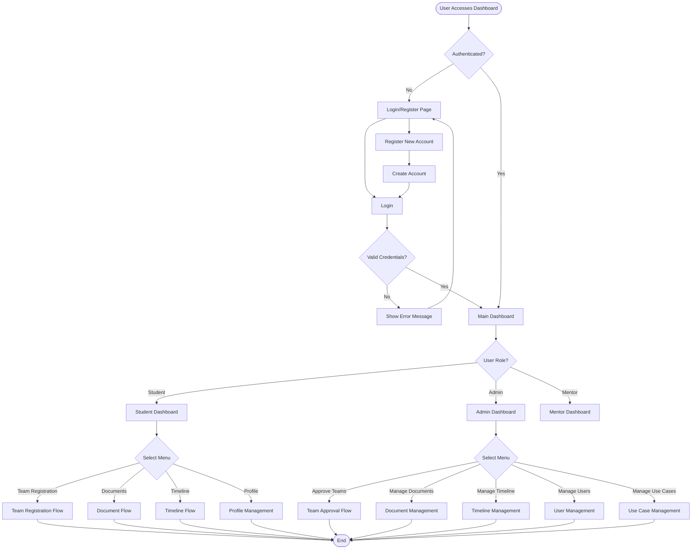
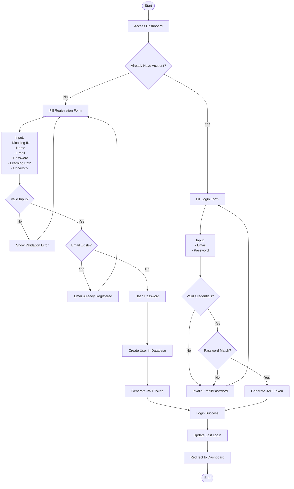
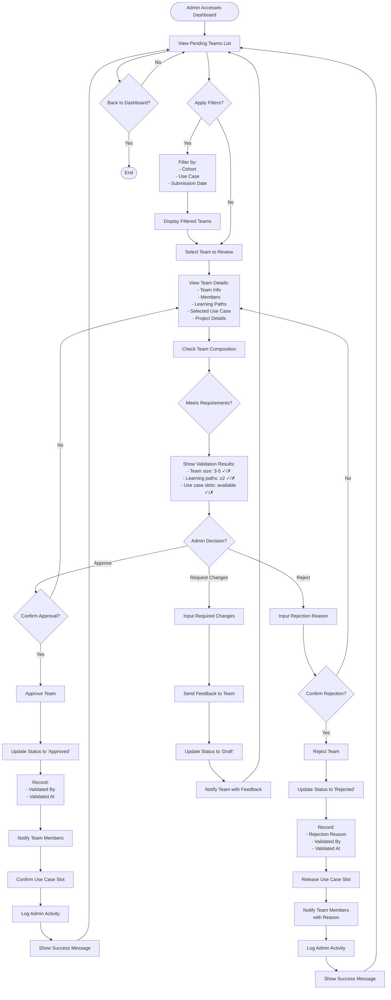
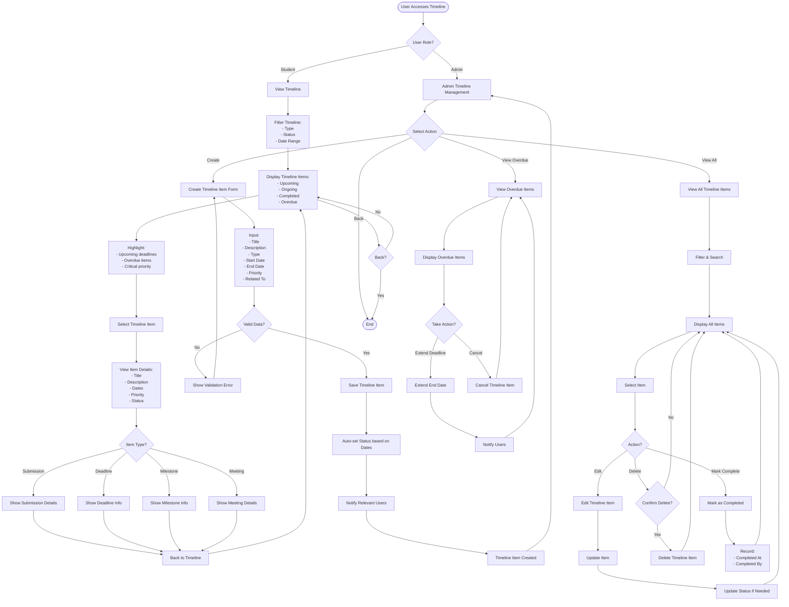

# System Flowchart - DC-09 Enhanced Academic Dashboard

**Project:** Dicoding Academic Dashboard - Capstone Project Management  
**Use Case:** DC-09  
**Version:** 1.0.0  
**Last Updated:** 8 November 2025

---

## 📋 Table of Contents

1. [Overall System Flow](#overall-system-flow)
2. [User Registration & Authentication Flow](#user-registration--authentication-flow)
3. [Team Registration Flow](#team-registration-flow)
4. [Admin Approval Flow](#admin-approval-flow)
5. [Document Management Flow](#document-management-flow)
6. [Timeline Management Flow](#timeline-management-flow)

---

## 🌐 Overall System Flow



---

## 🔐 User Registration & Authentication Flow



---

## 👥 Team Registration Flow (Combined with Company Recommendation)

```mermaid
flowchart TD
    Start([Student Accesses Capstone Menu]) --> CheckTeam{Already in Team?}
    
    CheckTeam -->|Yes| ShowTeamInfo[Display Team Information]
    ShowTeamInfo --> TeamStatus{Team Status?}
    
    TeamStatus -->|Draft| EditTeam[Edit Team Details]
    TeamStatus -->|Pending| WaitApproval[Wait for Admin Approval]
    TeamStatus -->|Approved| ViewTeamDetails[View Team Details & Documents]
    TeamStatus -->|Rejected| ViewReason[View Rejection Reason]
    ViewReason --> EditTeam
    
    EditTeam --> TeamMenu
    ViewTeamDetails --> End([End])
    WaitApproval --> End
    
    CheckTeam -->|No| ShowOptions[Display Options:<br/>1. Create New Team<br/>2. View Pending Invitations]
    
    ShowOptions --> UserChoice{User Choice?}
    
    UserChoice -->|Create Team| CreateTeamForm[Fill Team Registration Form]
    CreateTeamForm --> InputTeamData[Input:<br/>- Team ID<br/>- Team Name<br/>- Cohort ID]
    
    InputTeamData --> ValidateTeamData{Valid Data?}
    ValidateTeamData -->|No| ShowError1[Show Validation Error]
    ShowError1 --> CreateTeamForm
    
    ValidateTeamData -->|Yes| CheckTeamID{Team ID Available?}
    CheckTeamID -->|No| ShowError2[Team ID Already Exists]
    ShowError2 --> CreateTeamForm
    
    CheckTeamID -->|Yes| CreateTeamDraft[Create Team (Draft Status)]
    CreateTeamDraft --> AddMembers[Add Team Members]
    
    AddMembers --> SelectMembers[Select Members:<br/>Min: 3, Max: 5]
    SelectMembers --> SendInvitations[Send Invitations to Members]
    SendInvitations --> WaitInvitations[Wait for All Members to Accept]
    
    WaitInvitations --> CheckInvitations{All Accepted?}
    CheckInvitations -->|No| ShowPending[Show Pending Invitations<br/>Display: Who accepted, who pending]
    ShowPending --> WaitInvitations
    
    CheckInvitations -->|Yes| SelectUseCase[Select Use Case]
    SelectUseCase --> ShowUseCases[Display Available Use Cases]
    ShowUseCases --> ChooseUseCase[Choose Use Case]
    
    ChooseUseCase --> CheckSlots{Slots Available?}
    CheckSlots -->|No| ShowError3[No Slots Available]
    ShowError3 --> ShowUseCases
    
    CheckSlots -->|Yes| ValidateComposition[Validate Team Composition]
    ValidateComposition --> CheckLearningPaths{Valid Learning Paths?}
    
    CheckLearningPaths -->|No| ShowError4[Team must have<br/>at least 2 different<br/>learning paths]
    ShowError4 --> AddMembers
    
    CheckLearningPaths -->|Yes| CheckTeamSize{Valid Team Size?}
    CheckTeamSize -->|No| ShowError5[Team must have<br/>3-5 members]
    ShowError5 --> AddMembers
    
    CheckTeamSize -->|Yes| InputProjectDetails[Input Project Details:<br/>- Project Title<br/>- Description<br/>- GitHub Repo]
    
    InputProjectDetails --> ReviewSubmission[Review All Information]
    ReviewSubmission --> ConfirmSubmit{Confirm Submit?}
    
    ConfirmSubmit -->|No| TeamMenu{Edit What?}
    TeamMenu -->|Members| AddMembers
    TeamMenu -->|Use Case| SelectUseCase
    TeamMenu -->|Project Details| InputProjectDetails
    
    ConfirmSubmit -->|Yes| SubmitForApproval[Submit for Admin Approval]
    SubmitForApproval --> UpdateStatus[Update Status to 'Pending']
    UpdateStatus --> ReserveSlot[Reserve Use Case Slot]
    ReserveSlot --> NotifyAdmin[Notify Admin]
    NotifyAdmin --> ShowSuccess[Show Success Message:<br/>'Team submitted for approval']
    ShowSuccess --> WaitApproval
    
    UserChoice -->|View Invitations| ShowInvitationList[Display Pending Invitations]
    ShowInvitationList --> SelectInvitation[Select Invitation]
    SelectInvitation --> ViewInvitationDetails[View Team Details]
    ViewInvitationDetails --> InvitationChoice{Accept or Reject?}
    
    InvitationChoice -->|Accept| AcceptInvitation[Accept Invitation]
    AcceptInvitation --> JoinTeam[Join Team]
    JoinTeam --> UpdateUserTeam[Update User's Team ID]
    UpdateUserTeam --> NotifyTeamLeader[Notify Team Leader]
    NotifyTeamLeader --> ShowTeamInfo
    
    InvitationChoice -->|Reject| RejectInvitation[Reject Invitation]
    RejectInvitation --> NotifyTeamLeader2[Notify Team Leader]
    NotifyTeamLeader2 --> ShowInvitationList
```

---

## 👨‍💼 Admin Approval Flow



---

## 📄 Document Management Flow

```mermaid
flowchart TD
    Start([User Accesses Documents]) --> CheckRole{User Role?}
    
    CheckRole -->|Student| StudentDocView[View Documents]
    StudentDocView --> FilterDocs[Filter Documents:<br/>- Category<br/>- Tags<br/>- Search]
    FilterDocs --> ShowDocs[Display Available Documents:<br/>- Public<br/>- Team-only (if in team)]
    
    ShowDocs --> SelectDoc[Select Document]
    SelectDoc --> CheckAccess{Has Access?}
    CheckAccess -->|No| ShowError[Access Denied]
    ShowError --> ShowDocs
    
    CheckAccess -->|Yes| ViewDoc[View Document Details]
    ViewDoc --> DocAction{Action?}
    DocAction -->|Download| DownloadDoc[Download Document]
    DownloadDoc --> IncrementCount[Increment Download Count]
    IncrementCount --> UpdateTimestamp[Update Last Downloaded]
    UpdateTimestamp --> ShowDocs
    
    DocAction -->|View| ViewInBrowser[View in Browser]
    ViewInBrowser --> ShowDocs
    
    DocAction -->|Back| ShowDocs
    
    CheckRole -->|Admin| AdminDocView[Admin Document Management]
    AdminDocView --> AdminMenu{Select Action}
    
    AdminMenu -->|Upload| UploadForm[Upload Document Form]
    UploadForm --> InputDocData[Input:<br/>- Title<br/>- Description<br/>- Category<br/>- Visibility<br/>- Tags<br/>- Related To]
    
    InputDocData --> SelectFile[Select File to Upload]
    SelectFile --> ValidateFile{Valid File?}
    ValidateFile -->|No| ShowError2[Invalid file type/size]
    ShowError2 --> SelectFile
    
    ValidateFile -->|Yes| UploadFile[Upload to Storage]
    UploadFile --> SaveMetadata[Save Document Metadata]
    SaveMetadata --> ShowSuccess[Upload Success]
    ShowSuccess --> AdminDocView
    
    AdminMenu -->|View All| ViewAllDocs[View All Documents]
    ViewAllDocs --> FilterAdminDocs[Filter & Search]
    FilterAdminDocs --> ShowAllDocs[Display All Documents]
    ShowAllDocs --> SelectAdminDoc[Select Document]
    SelectAdminDoc --> AdminDocAction{Action?}
    
    AdminDocAction -->|Edit| EditDoc[Edit Document Metadata]
    EditDoc --> UpdateDoc[Update Document]
    UpdateDoc --> ShowAllDocs
    
    AdminDocAction -->|Delete| ConfirmDelete{Confirm Delete?}
    ConfirmDelete -->|No| ShowAllDocs
    ConfirmDelete -->|Yes| DeleteDoc[Delete Document]
    DeleteDoc --> RemoveFile[Remove from Storage]
    RemoveFile --> ShowAllDocs
    
    AdminDocAction -->|View Stats| ViewStats[View Download Statistics]
    ViewStats --> ShowAllDocs
    
    AdminMenu -->|Back| End([End])
    ShowDocs --> BackStudent{Back?}
    BackStudent -->|Yes| End
    BackStudent -->|No| ShowDocs
```

---

## 📅 Timeline Management Flow



---

## 📊 Data Flow Summary

### **User → System:**
1. Registration → Authentication → Dashboard
2. Team Creation → Validation → Approval Request
3. Document Access → Permission Check → Download
4. Timeline View → Filter → Display

### **Admin → System:**
1. Review Teams → Approve/Reject → Notify Users
2. Upload Documents → Set Permissions → Publish
3. Create Timeline → Set Dates → Notify Users
4. Manage Users → Update Roles → Update Permissions

### **System → Database:**
1. User actions → Validate → Store
2. Status changes → Update → Log
3. File uploads → Store → Generate URL
4. Notifications → Queue → Send

---

## 🔄 Integration Points

### **Frontend ↔ Backend:**
- REST API calls
- JWT authentication
- Real-time updates (optional)
- File upload/download

### **Backend ↔ Database:**
- Mongoose ODM
- CRUD operations
- Aggregation queries
- Transactions

### **System ↔ External:**
- Email notifications (future)
- File storage (local/cloud)
- Analytics (future)

---

## 📝 Notes

### **Key Decision Points:**
1. **Team Registration:** Invitation acceptance is required from all members
2. **Admin Approval:** Can approve, reject, or request changes
3. **Document Access:** Role-based and visibility-based
4. **Timeline Status:** Auto-updated based on dates

### **Validation Rules:**
1. **Team Size:** 3-5 members
2. **Learning Paths:** Minimum 2 different paths
3. **Use Case Slots:** Must be available
4. **File Upload:** Max 5MB, specific formats

### **Status Transitions:**
- **Team:** Draft → Pending → Approved/Rejected
- **Timeline:** Upcoming → Ongoing → Completed/Overdue
- **Document:** Active → Inactive (soft delete)

---

**Last Updated:** 8 November 2025  
**Maintained by:** Tim A25-CS246  
**Version:** 1.0.0
