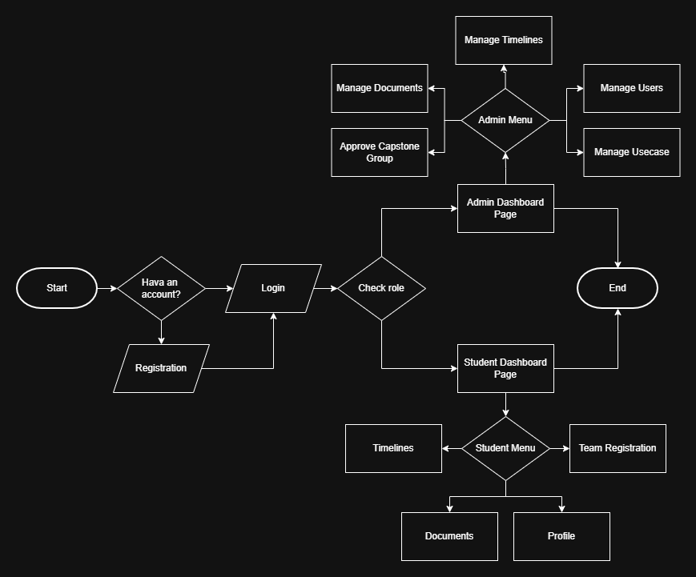
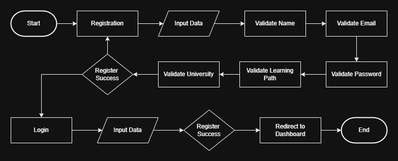
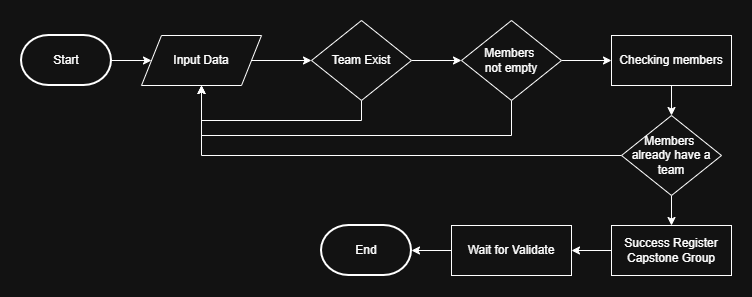
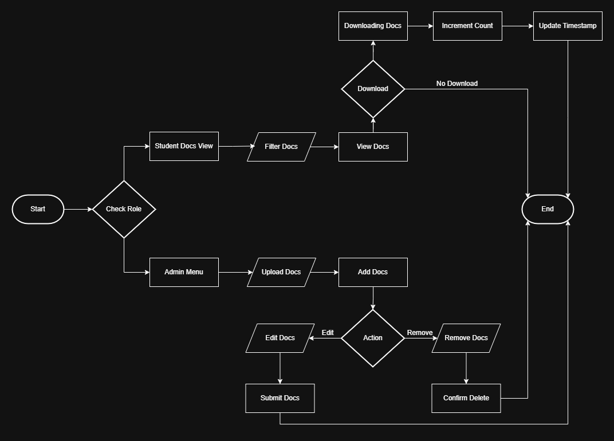
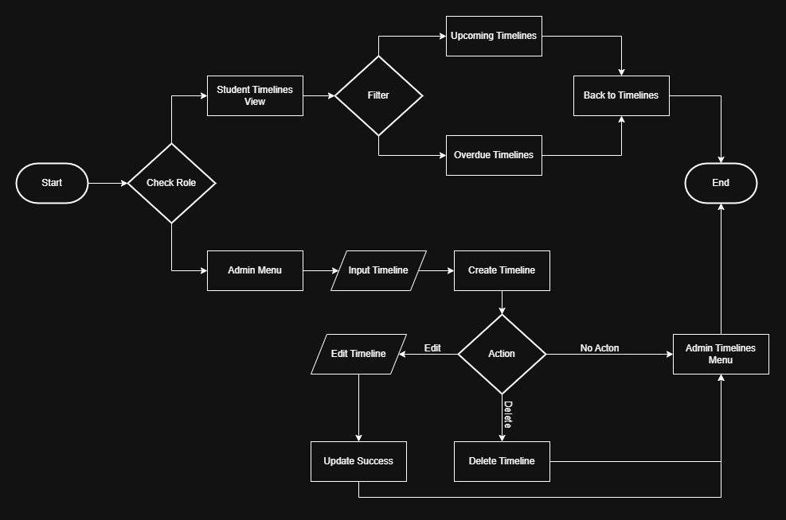

# System Flowchart - DC-09 Enhanced Academic Dashboard

**Project:** Dicoding Academic Dashboard - Capstone Project Management
**Use Case:** DC-09
**Version:** 1.0.0
**Last Updated:** 8 November 2025

---

## 📋 Table of Contents

1. [Overall System Flow](#overall-system-flow)
2. [User Registration & Authentication Flow](#user-registration--authentication-flow)
3. [Team Registration Flow](#team-registration-flow)
4. [Admin Approval Flow](#admin-approval-flow)
5. [Document Management Flow](#document-management-flow)
6. [Timeline Management Flow](#timeline-management-flow)

---

## 🌐 Overall System Flow

---

## 🔐 User Registration & Authentication Flow

---

## 👥 Capston Group Registration Flow

---

## 📄 Document Management Flow

---

## 📅 Timeline Management Flow

---

## 📊 Data Flow Summary

### **User → System:**
1. Registration → Authentication → Dashboard
2. Capston Group Creation → Validation → Approval Request
3. Document Access → Permission Check → Download
4. Timeline View → Filter → Display

### **Admin → System:**
1. Review Capstone Groups → Approve/Reject → Notify Users
2. Upload Documents → Set Permissions → Publish
3. Create Timeline → Set Dates → Notify Users
4. Manage Users → Update Roles → Update Permissions

### **System → Database:**
1. User actions → Validate → Store
2. Status changes → Update → Log
3. File uploads → Store → Generate URL
4. Notifications → Queue → Send

---

## 🔄 Integration Points

### **Frontend ↔ Backend:**
- REST API calls
- JWT authentication
- Real-time updates (optional)
- File upload/download

### **Backend ↔ Database:**
- Mongoose ODM
- CRUD operations
- Aggregation queries
- Transactions

### **System ↔ External:**
- Email notifications (future)
- File storage (local/cloud)
- Analytics (future)

---

**Last Updated:** 11 November 2025

**Maintained by:** Tim A25-CS246

**Version:** 1.0.0
